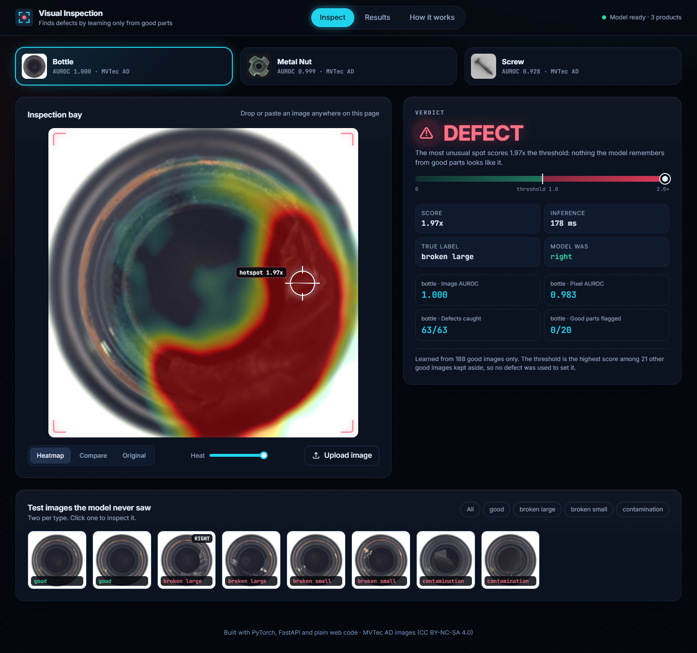
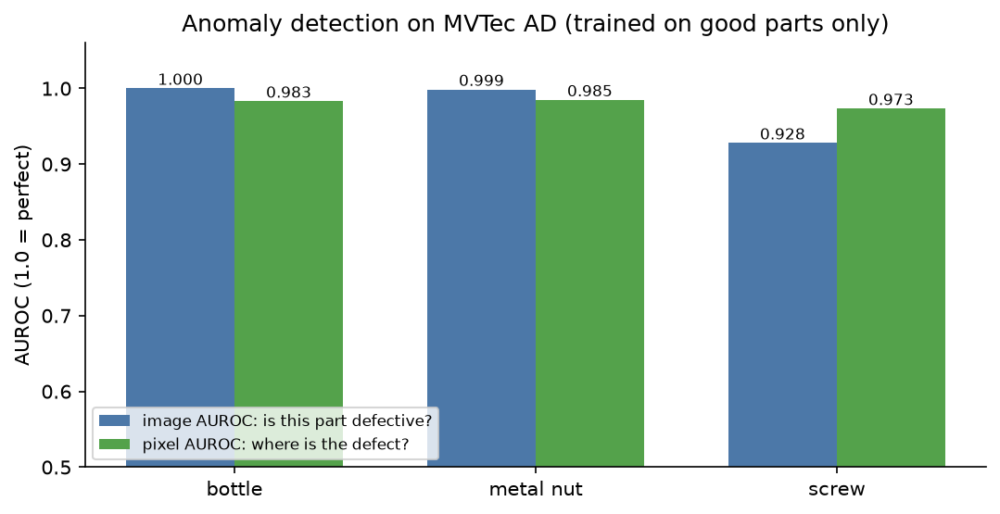
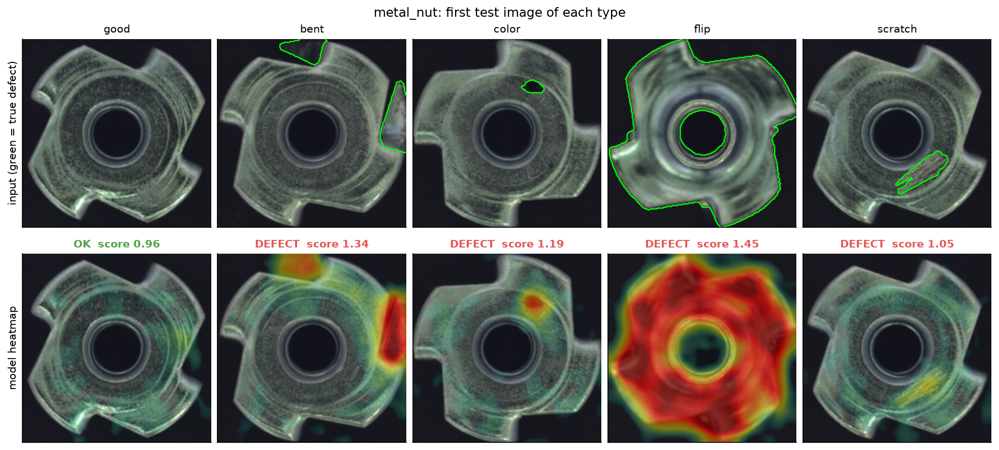
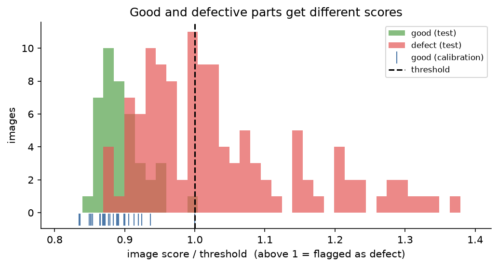
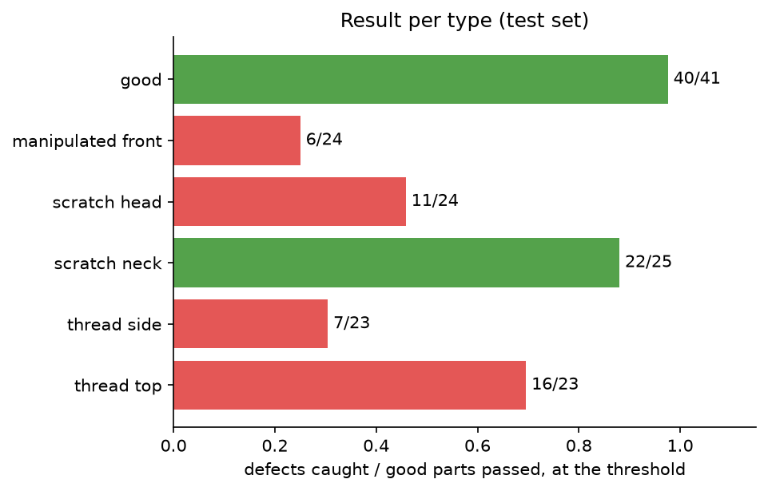

# Visual Inspection with Anomaly Detection

Find defects on industrial parts by learning **only from good parts**, and show where the defect is with a
heatmap. A compact PatchCore-style re-implementation in PyTorch (about 140 lines), evaluated on the MVTec AD
benchmark, with a FastAPI backend and a hand-built web app (scanning animation, heatmap, hotspot reticle,
before/after compare). Runs on a laptop CPU.



## Why anomaly detection

On a production line, defects are rare and new defect types keep appearing, so collecting and labelling
thousands of defect photos is slow. This model never sees a defect while it learns: it remembers what good
parts look like and flags anything that differs. The alarm threshold is also set from good parts only.

## Results

MVTec AD test sets; images never used for learning or for the threshold. Speed is the average per image in
batches of 16 on an Intel Core i7-13700K CPU.

| Product | Learned from | Image AUROC | Pixel AUROC | Defects caught | Good parts flagged | Speed |
|---|---|---|---|---|---|---|
| bottle | 188 good images | **1.000** | 0.983 | 63 / 63 | 0 / 20 | 68 ms |
| metal nut | 198 good images | **0.999** | 0.985 | 93 / 93 | 2 / 22 | 65 ms |
| screw | 288 good images | 0.928 | 0.973 | 62 / 119 | 1 / 41 | 70 ms |

- **Image AUROC**: the chance that a defective part scores higher than a good one. **Pixel AUROC**: the same for
  pixels inside vs. outside the true defect, i.e. how well the heatmap localises it.
- **Screw is the hard case**: the defects are tiny and every screw lies at a different angle. The ranking is still
  good (AUROC 0.928), but at a threshold strict enough to flag only 1 of 41 good screws, about half of the defects
  get through. Choosing the operating point is a business decision: a lower threshold catches more defects and
  stops more good parts.



| Heatmaps on the first test image of each type (metal nut) |
|---|
|  |

| Good vs. defective scores (screw) | Result per defect type (screw) |
|---|---|
|  |  |

Full numbers and figures per product: [reports/RESULTS.md](reports/RESULTS.md).

## How it works

1. **See**: a Wide ResNet-50 pretrained on ImageNet (frozen, never retrained) describes every area of a
   224 x 224 image with 1,536 numbers, on a 28 x 28 grid of patches (layers 2 and 3, each patch averaged with its
   neighbours).
2. **Remember**: the patch descriptions of all good training images (about 150,000 to 225,000) form a memory bank.
   A greedy k-center coreset keeps 1% of them that still cover the rest.
3. **Compare**: every patch of a new image is matched to its nearest remembered good patch. The distances,
   upsampled and smoothed, are the heatmap; its maximum is the image score.
4. **Decide**: 10% of the good training images are held out; the threshold is the highest score among them.

### Design decisions, measured

| Choice | Alternative | Result |
|---|---|---|
| Coreset 1% | 10% (bottle, all 209 training images) | pixel AUROC 0.983 vs. 0.984, but 39 s vs. 241 s to build and faster inference |
| Center crop, as in the benchmark | whole image resized (screw) | image AUROC 0.928 vs. 0.910, pixel AUROC 0.973 vs. 0.966 |
| Image score = max of the smoothed heatmap | max of the raw patch scores (screw) | image AUROC 0.928 vs. 0.908 |

## Run it

Windows: double-click `setup.bat` once (environment, packages, about 500 MB of images, about 3 minutes of
training), then `start_demo.bat`. The demo opens in your browser.

Any OS:

```bash
python -m venv .venv
.venv/Scripts/activate              # macOS/Linux: source .venv/bin/activate
pip install -r requirements.txt
python -m src.train                 # downloads MVTec AD bottle, metal_nut, screw and trains one model each
python app.py                       # http://127.0.0.1:7861
```

Other MVTec AD categories: `python -m src.train --categories zipper transistor`.

## Use your own images

Put images in this layout and train with `--data-dir`:

```
my_parts/train/good/            good images to learn from
my_parts/test/good/             good images to test on
my_parts/test/<defect type>/    defective images to test on
my_parts/ground_truth/<defect type>/<name>_mask.png    optional, for pixel AUROC
```

```bash
python -m src.train --data-dir my_parts --name my_parts --no-crop
python app.py                       # every trained model appears in the product list
```

`--no-crop` keeps the whole image, for parts whose defects can sit at the edge. `src/prepare_wd.py` builds this
layout from a folder of good and defect samples.

## Project structure

```
src/data.py        MVTec AD download, folder layout
src/patchcore.py   feature extractor, coreset, memory bank, heatmaps
src/train.py       learn, calibrate the threshold, evaluate, figures, reports
src/plots.py       heatmap overlay and figures
src/prepare_wd.py  copy a sample of an image folder into the layout above
app.py             FastAPI server: JSON API + the web page
web/               the web page (index.html, styles.css, app.js), no build step
```

## Limitations and next steps

- One model per product; an image of another product is flagged as a defect, which is expected.
- Not rotation-aware: screws at unusual angles look unusual. Ideas: align parts first, add rotated copies of the
  good images, or use a larger input size for small parts.
- The threshold rule (maximum of the held-out good scores) is simple; with a few labelled defects one could tune it
  for a target miss rate.

## Credits

- Data: MVTec AD, Paul Bergmann, Kilian Batzner, Michael Fauser, David Sattlegger, Carsten Steger,
  *The MVTec Anomaly Detection Dataset* (IJCV 2021) and *MVTec AD — A Comprehensive Real-World Dataset for
  Unsupervised Anomaly Detection* (CVPR 2019). Licensed
  [CC BY-NC-SA 4.0](https://creativecommons.org/licenses/by-nc-sa/4.0/): non-commercial use only. The images in this
  README and in `docs/` are derived from MVTec AD under the same license.
- Method: Karsten Roth et al., *Towards Total Recall in Industrial Anomaly Detection* (CVPR 2022), re-implemented
  here from the paper's description.
- Backbone: torchvision's Wide ResNet-50-2 ImageNet weights.
