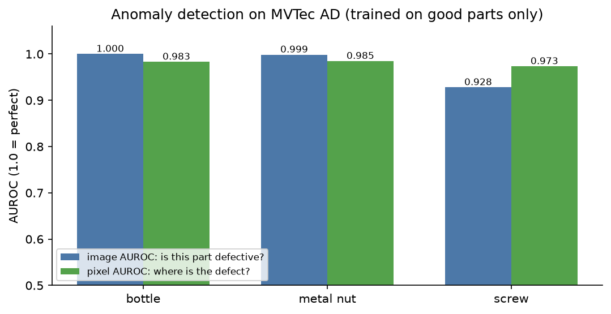

# Results

| Model | Data | Image AUROC | Pixel AUROC | Defects caught | Good parts flagged | ms / image |
|---|---|---|---|---|---|---|
| [bottle](bottle/RESULTS.md) | MVTec AD (CC BY-NC-SA 4.0) | 1.000 | 0.983 | 100.0% | 0.0% | 68 |
| [metal_nut](metal_nut/RESULTS.md) | MVTec AD (CC BY-NC-SA 4.0) | 0.999 | 0.985 | 100.0% | 9.1% | 65 |
| [screw](screw/RESULTS.md) | MVTec AD (CC BY-NC-SA 4.0) | 0.928 | 0.973 | 52.1% | 2.4% | 70 |

