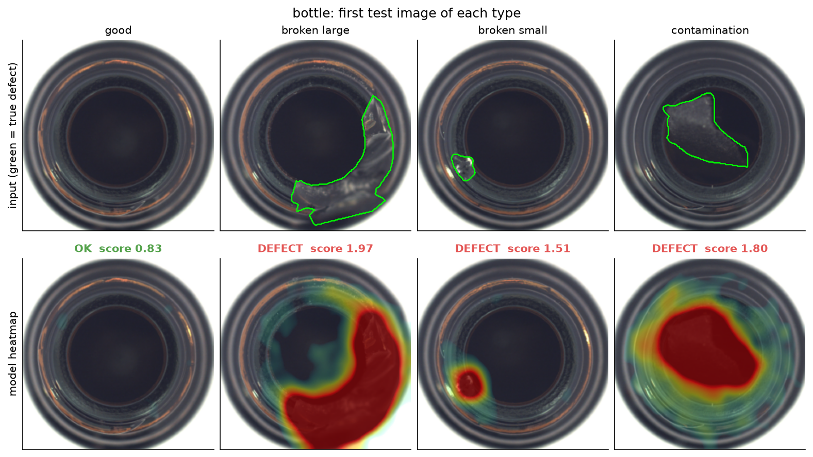
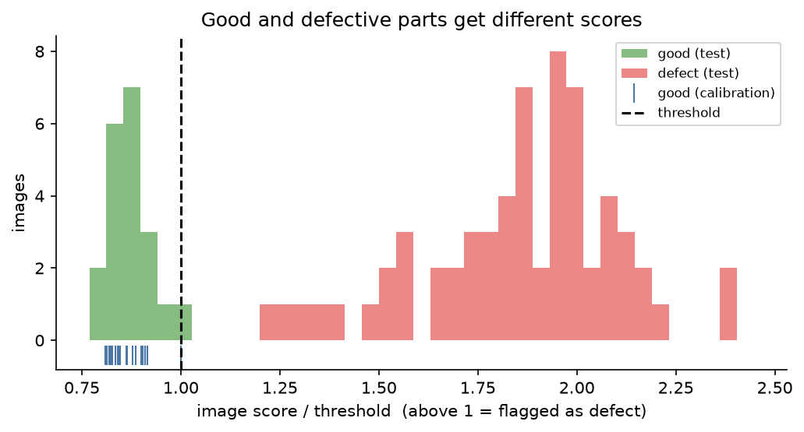
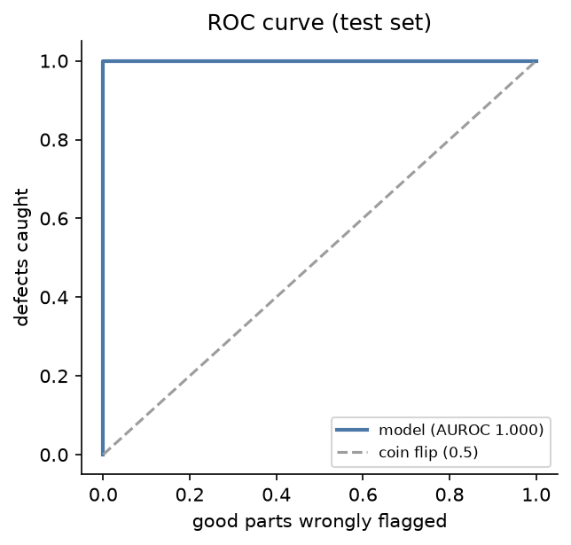
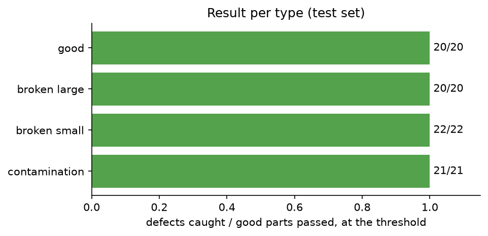

# Results: bottle

Generated by `python -m src.train` on 2026-11-16 17:24. Source: MVTec AD (CC BY-NC-SA 4.0).

Learned from **188 good images** only (memory bank of 1,473 patches out of 147,392); threshold set on 21 other good images; tested on 83 images.

| Metric | Value | Meaning |
|---|---|---|
| Image AUROC | 1.000 | does a defective part score higher than a good one? 1 = always |
| Pixel AUROC | 0.983 | do defect pixels score higher than normal pixels? |
| Defects caught | 63 / 63 (100.0%) | at the threshold |
| Good parts wrongly flagged | 0 / 20 (0.0%) | at the threshold |
| Speed | 68 ms per image | CPU, Intel64 Family 6 Model 183 Stepping 1, GenuineIntel |

| Type | Flagged as defect |
|---|---|
| good | 0 / 20 |
| broken_large | 20 / 20 |
| broken_small | 22 / 22 |
| contamination | 21 / 21 |

## Figures

### Heatmaps on test images

### Scores of good vs. defective parts

### ROC curve

### Result per defect type

