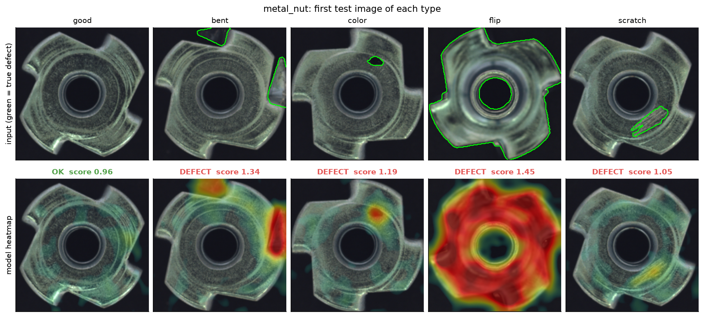
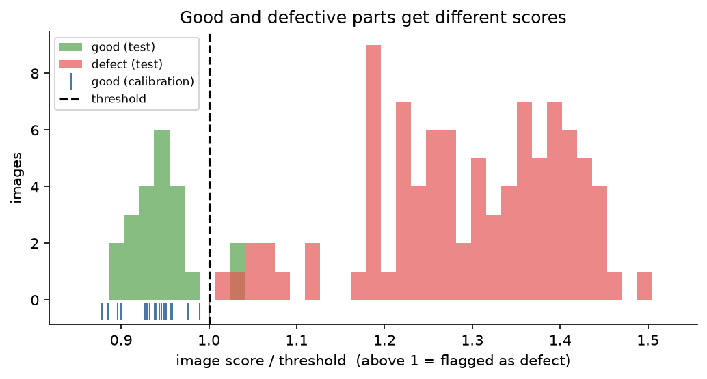
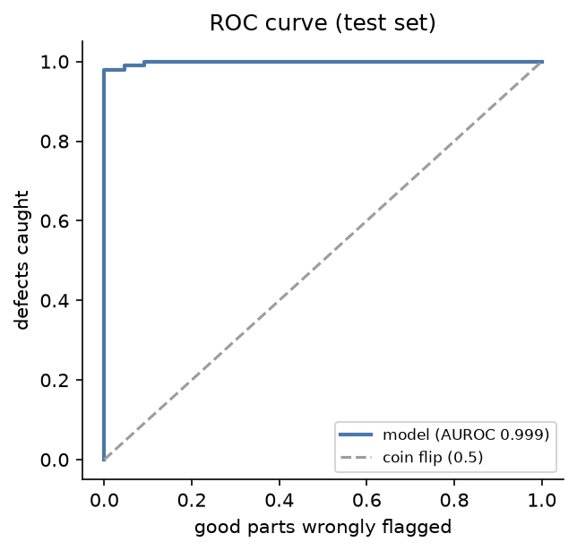
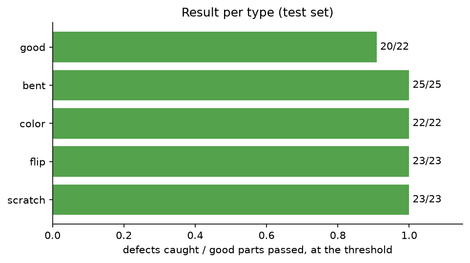

# Results: metal_nut

Generated by `python -m src.train` on 2026-11-19 10:38. Source: MVTec AD (CC BY-NC-SA 4.0).

Learned from **198 good images** only (memory bank of 1,552 patches out of 155,232); threshold set on 22 other good images; tested on 115 images.

| Metric | Value | Meaning |
|---|---|---|
| Image AUROC | 0.999 | does a defective part score higher than a good one? 1 = always |
| Pixel AUROC | 0.985 | do defect pixels score higher than normal pixels? |
| Defects caught | 93 / 93 (100.0%) | at the threshold |
| Good parts wrongly flagged | 2 / 22 (9.1%) | at the threshold |
| Speed | 64 ms per image | CPU, Intel64 Family 6 Model 183 Stepping 1, GenuineIntel |

| Type | Flagged as defect |
|---|---|
| good | 2 / 22 |
| bent | 25 / 25 |
| color | 22 / 22 |
| flip | 23 / 23 |
| scratch | 23 / 23 |

## Figures

### Heatmaps on test images

### Scores of good vs. defective parts

### ROC curve

### Result per defect type

