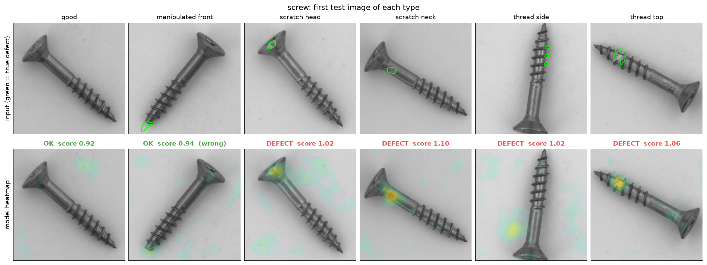
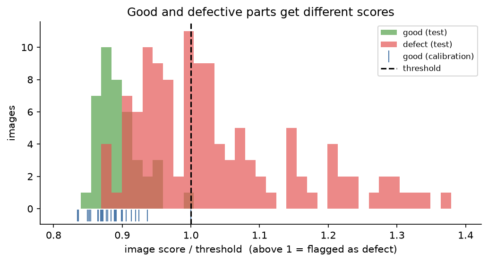
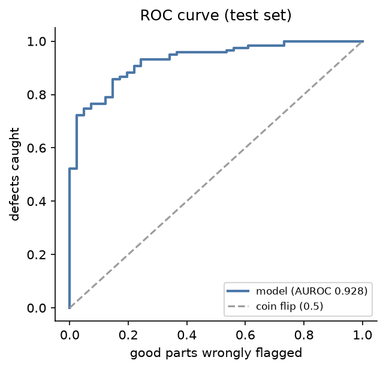
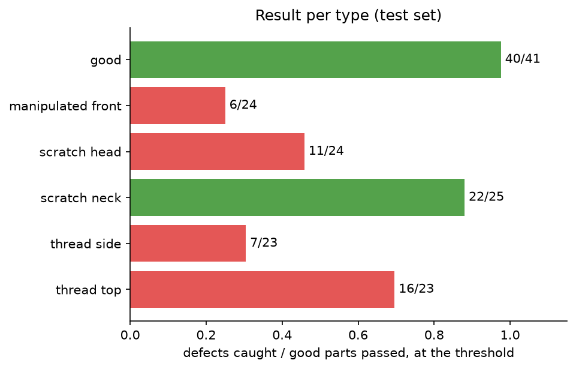

# Results: screw

Generated by `python -m src.train` on 2026-11-19 10:40. Source: MVTec AD (CC BY-NC-SA 4.0).

Learned from **288 good images** only (memory bank of 2,257 patches out of 225,792); threshold set on 32 other good images; tested on 160 images.

| Metric | Value | Meaning |
|---|---|---|
| Image AUROC | 0.928 | does a defective part score higher than a good one? 1 = always |
| Pixel AUROC | 0.973 | do defect pixels score higher than normal pixels? |
| Defects caught | 62 / 119 (52.1%) | at the threshold |
| Good parts wrongly flagged | 1 / 41 (2.4%) | at the threshold |
| Speed | 68 ms per image | CPU, Intel64 Family 6 Model 183 Stepping 1, GenuineIntel |

| Type | Flagged as defect |
|---|---|
| good | 1 / 41 |
| manipulated_front | 6 / 24 |
| scratch_head | 11 / 24 |
| scratch_neck | 22 / 25 |
| thread_side | 7 / 23 |
| thread_top | 16 / 23 |

## Figures

### Heatmaps on test images

### Scores of good vs. defective parts

### ROC curve

### Result per defect type

