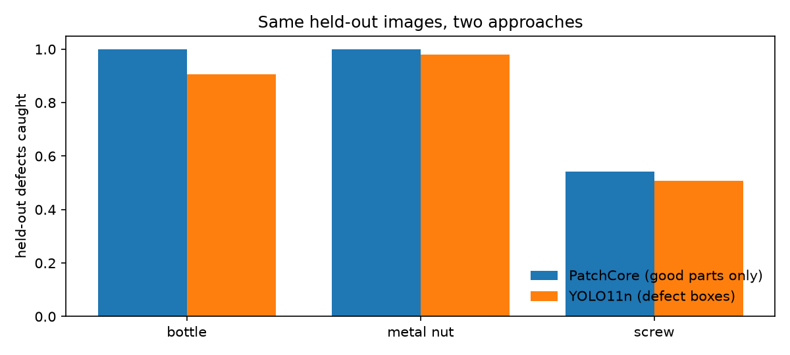
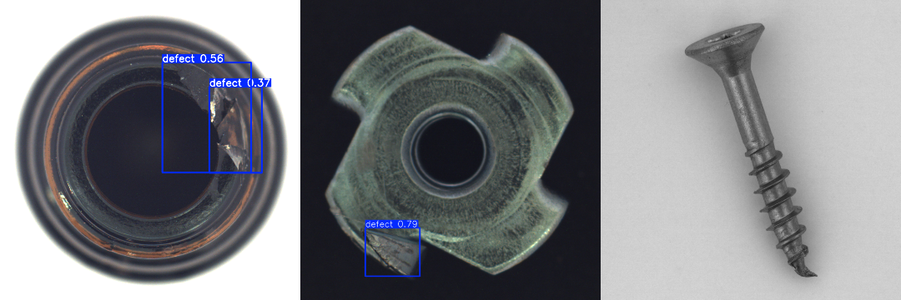

# YOLO vs. PatchCore

Each product's MVTec AD test images were split in half per defect type (seed 0). YOLO11n (COCO-pretrained,
fine-tuned on CPU for 50 epochs at 512 px, 23 min) learned from one half, with boxes
drawn by OpenCV around the ground-truth masks. PatchCore learned from good training images only and never
saw a defect. Both are scored on the other half. A YOLO box at confidence >= 0.25 counts as a defect; PatchCore uses its own threshold set on good parts.

| Product | Held-out defects | YOLO caught | PatchCore caught | YOLO false alarms | PatchCore false alarms |
|---|---|---|---|---|---|
| bottle | 32 | 29 | 32 | 0/10 | 0/10 |
| metal_nut | 48 | 47 | 48 | 0/11 | 1/11 |
| screw | 61 | 31 | 33 | 1/21 | 0/21 |

YOLO box quality on the held-out half (all products): mAP50 0.619, mAP50-95 0.374.

